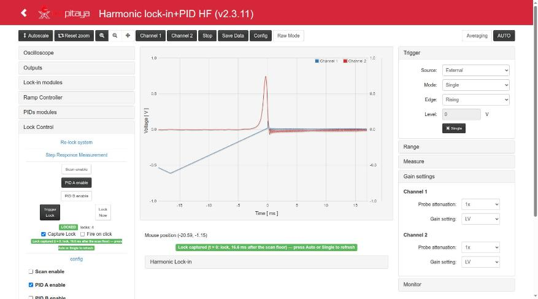

# Red Pitaya Lock-in+PID Application with HARMONIC High Frequency modulation

This started being a striped version of [lock-in+PID](https://github.com/marceluda/rp_lock-in_pid) project. Now it incorporated some new features that make it another App.

This High Frequency version is a copy of [Lock-in+PID Harmonic](https://github.com/marceluda/rp_lock-in_pid_h) with only one change: **The harmonic motulation signal frequencies can be set from 60 Hz to 1 MHz** (63.6 Hz to 1.04 MHz: the period of the modulation has 120 table points instead of 2520).

It is an application for the [Red Pitaya STEMlab 125-14](https://www.redpitaya.com/) board (RP): a set of
instruments built in the FPGA (oscilloscope, harmonic lock-in amplifier, two PIDs, ramp generator and
automatic lock control) to measure a system with modulation techniques and stabilize it with a feedback
loop, controlled from a web page or remotely over HTTP.

[](http://www.youtube.com/watch?v=330eYE75MYQ "Fast demosatration of usage")




## Version 2.3.x (Ecosystem 2.0)

Current version: **2.3.12** (branch `devel2.0`).

This version is **based on the 0.3.x series (v0.3.9), with the FPGA design built in Vivado 2020.1**,
using the project structure of [RedPitaya-FPGA](https://github.com/RedPitaya/RedPitaya-FPGA)
(project `v0.94`, model `Z10`), the same port done in
[rp_lock-in_pid_h](https://github.com/marceluda/rp_lock-in_pid_h) v2.3.x: v2.3.11 has all the changes of its
v2.3.10 to v2.3.17 (lock sequence in the FPGA, Capture Lock, HTTP remote control on Ecosystem 2.0...), and
v2.3.12 the minor fixes of its v2.3.18 (same FPGA). It is
intended for the Red Pitaya **Ecosystem 2.0** (e.g. `RedPitaya_OS_2.04`; tested on 2.04-35).
The 0.3.x series (branch `master`, FPGA with Vivado 2015.2) is the version for the 0.9x / 1.0 ecosystems.

- HF: the harmonic modulation has a period of 120 table points (lock_in+pid_harmonic: 2520), so its
  frequency is 125 MHz / (120 * (`gen_mod_hp` + 1)) = 1.04 MHz .. 63.6 Hz, and `gen_mod_phase` is 0..119
  (3 degrees per step). Configs of lock_in+pid_harmonic have another frequency here (hp 0 = 1.04 MHz):
  see [doc/Usage.md](doc/Usage.md#hf-notes).
- FPGA: `lock_in+pid_harmonic_hf/fpga/` (Vivado 2020.1, see
  [lock_in+pid_harmonic_hf/fpga/README.md](lock_in+pid_harmonic_hf/fpga/README.md)). Oscilloscope of the
  Ecosystem 2.0 (trigger lock, decimation widened to 20 bits: time ranges up to ~68 s), exact bus reads of the
  lock module. Same register map as lock_in+pid_harmonic.
- Lock control in the FPGA (`lock_status` at 0x1C replaces `lock_feedback`; trigger inputs registered for
  timing), **Capture Lock** and **Fire on click**: see
  [lock_control.md](lock_in+pid_harmonic_hf/doc/lock_control.md) and [lock_capture.md](lock_in+pid_harmonic_hf/doc/lock_capture.md).
- Time / Level trigger fields with units (`16.58 ms`, `20 s`, `0.1 V`); Config → load applies the time window.
- Remote control from a PC over HTTP: `resources/remote_control/http_version/control_finn.py` and
  `example_usage.py` (frequencies and phases with the HF period of 120 points). See [doc/Remote.md](doc/Remote.md).
- Tested on the board with a real lock at **49.6 kHz and 104.2 kHz** against a simulated peak; a lock at
  1.04 MHz has not been tested yet.
- Only the App itself is packaged (the `_DEBUG` and `_RELOAD` flavours were removed).
- See the [CHANGELOG](CHANGELOG.md).


## Features

- Lock-in amplifier
- in-phase and quadrature Demodulation
  - Demodulation for arbitrary phase
  - Demodulatión for double and triple frequency
- Harmonic modulation from 63.6 Hz to 1.04 MHz, added to the outputs
- Two PID filters, for loop back stabilization
- Ramp/Scan controller for response analysis
- Lock control for automatic scan-stop / PID start (time, level or immediate trigger, run by the FPGA)
- Two-channel oscilloscope on any internal signal, triggered by internal events (scan floor, lock, ...)
- Streaming system for continued acquisition of two channels
- Remote control through HTTP API


**New Interface for lock-in R & Phase** :


[](http://www.youtube.com/watch?v=DzSK8IQkUE4 "New R-phase interphase")

**Decimation values of the oscilloscope**

| dec    | max oscilloscope lenght |
|--------|-------------------------|
|      1 |             0.131072 ms |
|      8 |             1.048576 ms |
|     64 |             8.388608 ms |
|    128 |            16.777216 ms |
|    256 |            33.554432 ms |
|    512 |            67.108864 ms |
|   1024 |           134.217728 ms |
|   8192 |           1.073741824 s |
|  65536 |           8.589934592 s |
| 524288 |          68.719476736 s |


## Documentation

| Document | Contents |
|---|---|
| [doc/App.md](doc/App.md) | Instruments and technical data; differences with lock_in+pid_harmonic |
| [doc/Usage.md](doc/Usage.md) | Web interface and procedures (scan, lock-in, lock at 49.6 and 104 kHz), with screenshots |
| [doc/Structure.md](doc/Structure.md) | Web page ↔ server ↔ FPGA, block diagrams |
| [doc/FPGA.md](doc/FPGA.md) | Register map |
| [doc/Remote.md](doc/Remote.md) | Remote control over HTTP, Python examples |
| [doc/Devel.md](doc/Devel.md) | Building, modifying and testing |
| [CHANGELOG.md](CHANGELOG.md) | Changes by version |

The concepts of the instruments are also explained in the documentation of the original App:
https://marceluda.github.io/rp_lock-in_pid/


## Installation

If you have a RP board you can install the **Lock-in+PID** application
by copying the `lock_in+pid_harmonic_hf` folder (that comes with this tar/zip file) to the
`/opt/redpitaya/www/apps` folder (inside the RP).

The packages are built in `archive/` (`lock_in+pid_harmonic_hf-<version>-<build>-devbuild.{zip,tar.gz}`).
UnZip / UnTar the package and execute from terminal:

```bash
./upload_app.sh rp-XXXXXX.local
```

Replace `rp-XXXXXX.local` by your RP localname or IP address. Also, you can use your own SSH client and
upload the `lock_in+pid_harmonic_hf` folder to the RedPitaya folder `/opt/redpitaya/www/apps` (file system in
read-write mode, `fpga.sh` executable). Then open `http://rp-XXXXXX.local/lock_in+pid_harmonic_hf/`.

Or, from the App folder of the sources (builds `target/` first):

```bash
make upload RPIP=rp-XXXXXX.local        # whole App
make upload_html RPIP=rp-XXXXXX.local   # only index.html, js, css
```

Then stop and start the App (or open it from the menu) so that the new controller and FPGA are loaded.

For more information about installing procedure, refer to:
https://marceluda.github.io/rp_lock-in_pid/TheApp/install/ and [doc/Devel.md](doc/Devel.md#installing-on-the-board).


## Building

To build or modify the App you need a linux development environment with:
  - Vivado 2020.1 (FPGA and `bootgen`; `lock_in+pid_harmonic_hf/fpga/Makefile` loads
    `/tools/Xilinx/Vivado/2020.1/settings64.sh` by itself, override with `VIVADO_SETTINGS=...`)
  - gcc-linaro-4.9-2015.02-3-x86_64_arm-linux-gnueabihf (installed on `/opt/linaro/gcc-linaro-4.9-2015.02-3-x86_64_arm-linux-gnueabihf/`)
  - (the 0.3.x series, branch `master`, used Vivado 2015.2; `settings.sh` still loads it if present)

The App was based on code from project:
https://github.com/RedPitaya/RedPitaya/tree/release-v0.95/apps-free/scope

Run on terminal:

```bash
source settings.sh
LANG=C make          # controller, c/ tools, FPGA (if changed) and packages in archive/
```

Parts (from the root folder):

```bash
make -C lock_in+pid_harmonic_hf app        # C controller + c/ tools (cross compiled)
make -C lock_in+pid_harmonic_hf c_tools    # only the c/ tools (lock, osc, streaming)
make -C lock_in+pid_harmonic_hf fpga       # FPGA with Vivado 2020.1 (red_pitaya.bit, fpga.bit.bin)
make clean                                 # clean all (also: clean_app, clean_fpga in lock_in+pid_harmonic_hf)
```

The FPGA can also be built from `lock_in+pid_harmonic_hf/fpga` (`make`, `make project`, `make clean`); its
Makefile loads Vivado 2020.1 by itself. Requirements, all the targets, tests and details:
[doc/Devel.md](doc/Devel.md).


## License and citation

GPL-3.0 (see [LICENSE](LICENSE)). If you use this software, please cite: M. A. Luda, doi
[10.1063/1.5080345](https://doi.org/10.1063/1.5080345).
