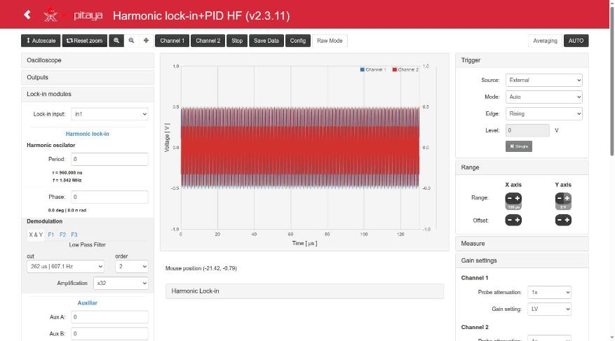
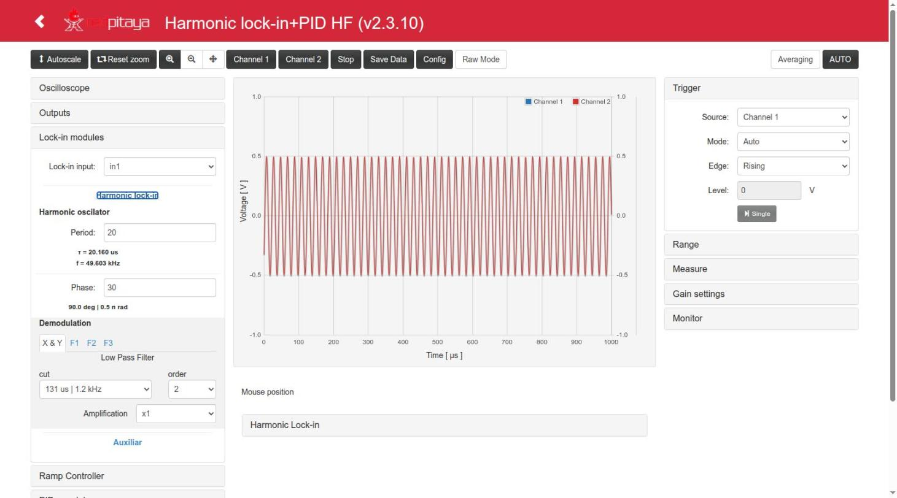

# The App: instruments and specifications

`lock_in+pid_harmonic_hf` ("Harmonic Lock-in+PID HF") **v2.3.11** for the Red Pitaya STEMlab 125-14,
Ecosystem 2.0 (tested on RedPitaya_OS 2.04-35). Branch `devel2.0`.

This App is [Lock-in+PID Harmonic](https://github.com/marceluda/rp_lock-in_pid_h) (`lock_in+pid_harmonic`
v2.3.17) with **one difference: the harmonic modulation has a period of 120 table points instead of 2520**, so
the modulation goes from **63.6 Hz to 1.04 MHz** (instead of 3.03 Hz to 49.6 kHz) and its phase has steps of 3°.
Everything else (filters, PIDs, ramp, lock control, scope, registers) is the same design.

This page describes what the App contains and its technical data. How to use it from the web page is in
[Usage.md](Usage.md); how the parts are connected in [Structure.md](Structure.md); the registers in
[FPGA.md](FPGA.md).

- [The instruments](#the-instruments)
- [What is different from lock_in+pid_harmonic](#what-is-different-from-lock_inpid_harmonic)
- [General data](#general-data)
- [Oscilloscope](#oscilloscope)
- [Inputs and outputs](#inputs-and-outputs)
- [Modulation generator](#modulation-generator)
- [Harmonic lock-in amplifier](#harmonic-lock-in-amplifier)
- [Ramp generator (scan)](#ramp-generator-scan)
- [Error signal and PIDs](#error-signal-and-pids)
- [Lock control (auto-lock)](#lock-control-auto-lock)
- [Re-lock and step response](#re-lock-and-step-response)
- [Monitor](#monitor)
- [Streaming](#streaming)
- [Remote control](#remote-control)

## The instruments

Like the [Lock-in+PID](https://marceluda.github.io/rp_lock-in_pid/TheApp/instruments/instruments_01_intro/)
App it comes from, this App is a set of "instruments" built inside the FPGA. They are not isolated
blocks: they are a logical division of one circuit (`lock.v`), whose signals can be routed to each other
with selectors, so that a measurement or a feedback loop is configured instead of wired.

| Instrument | What it does | Main registers |
|---|---|---|
| **Oscilloscope** | Two channels, any of 25 internal signals, 16384 samples, time spans from 131 µs to 68.7 s, external trigger from internal events | scope block 0x40100000, `oscA_sw`, `oscB_sw`, `trig_sw` |
| **Inputs / outputs** | Routing of 16 signals to the fast outputs OUT1/OUT2, with optional modulation added | `out1_sw`, `out2_sw`, `mod_out1`, `mod_out2` |
| **Modulation generator** | Harmonic local oscillator: `sin_ref`, `cos_ref` and `cos_1f`, `cos_2f`, `cos_3f` with adjustable phase, **63.6 Hz – 1.04 MHz** | `gen_mod_hp`, `gen_mod_phase` |
| **Harmonic lock-in** | Demodulation of one input at 1f (X, Y and F1 at an arbitrary phase), 2f (F2) and 3f (F3), with 1st/2nd order low-pass filters and gains | `signal_sw`, `lpf_F*`, `sg_amp*` |
| **Ramp generator** | Triangle or sawtooth scan on two outputs with a fixed ratio (A and B) | `ramp_*` |
| **Two PIDs** | PID A and PID B, wide range of gains and time constants, integrator saturation, freeze and reset | `pidA_*`, `pidB_*`, `error_sw`, `error_offset` |
| **Lock control** | Automatic transition from scan (open loop) to lock (closed loop) at a time, a level or immediately, executed by the FPGA | `lock_control`, `lock_status`, `lock_trig_*` |
| **Re-lock / step response** | Out-of-lock detection; a step added to the control signals to measure the loop response | `rl_*`, `sf_*` |
| **Monitor** | Mean and standard deviation of the error over ~1 s | `error_mean`, `error_std` |
| **Streaming** | Continuous transfer of the two scope channels to a computer over TCP | `stream_*` |
| **Remote control** | HTTP API to read and write all the registers, make scope acquisitions and run the lock (Python client `control_finn.py`) | `/lock`, `/osc`, `/data` |

The two control signals of the App are:

```
ctrl_A = PID A out + Ramp A (+ jump A)     → usually sent to OUT1
ctrl_B = PID B out + Ramp B (+ jump B)     → usually sent to OUT2
```

## What is different from lock_in+pid_harmonic

Checked by comparing the trees of both Apps (`devel2.0`: `_hf` `1da4aca` against `_h` `79e19eb`):

| Item | `lock_in+pid_harmonic` 2.3.17 | `lock_in+pid_harmonic_hf` 2.3.11 | Source |
|---|---|---|---|
| Period of the modulation (table points) | 2520 (quarter tables `data_*_ss.dat` of 630/315/210 points) | **120** (`data_sin1.dat`, `data_cos1.dat` of 30 points, `data_cos2.dat` 15, `data_cos3.dat` 10) | `lock/gen_mod_h.v` l. 27-36 (`mem_large`, `mem_f1..3`) |
| Modulation frequency | 3.03 Hz .. 49.603 kHz | **63.58 Hz .. 1.0417 MHz** | f = 125 MHz / (120 · (`gen_mod_hp` + 1)) |
| `gen_mod_phase` | 0..2519 (0.143° per step) | **0..119 (3° per step)** | `src/main.c` l. 361, `c/lock.txt`, `config_tool.py` |
| `PERIOD_LEN` in the UI / remote client | 2520 | **120** | `index.html` l. 86, `control_finn.py` l. 100 |
| Lock control (`lock_ctrl.v`) | trigger comparisons combinational | trigger inputs **registered** for timing (as `lock_in+pid` 2.2.6): Time trigger in the same clock as before, **Level trigger 1 clock (8 ns) later** | `lock/lock_ctrl.v` l. 96-110, 129-175 |
| Saved configs | migrated from the old shared key `lockConfig` | **not migrated** (configs of `_h` and HF have the same keys and can not be told apart) | `index.html` l. 5319-5322 |
| App name, endpoints | `lock_in+pid_harmonic` | `lock_in+pid_harmonic_hf` (`/lock_in+pid_harmonic_hf/lock`, `/osc`, ...) | `nginx.conf` |
| Version numbering | 2.3.17 | 2.3.11 (= the changes of `_h` 2.3.10 to 2.3.17) | `CHANGELOG.md` |

Not different: `lock.v` (only comments), the low-pass filters (`LP_filter3.v`), PIDs, ramp, scope, register map
(same 99 registers and addresses: `lock_control` 0x18, `lock_status` 0x1C), C controller (except the phase
range and the streaming paths), `c/` tools and `py/` scripts. So the time constants of the filters and all the
other numbers of this page are those of `_h`.

## General data

| Item | Value | Source |
|---|---|---|
| Board | STEMlab 125-14 (Zynq 7010, model Z10) | `fpga/README.md` |
| Ecosystem | 2.0 (RedPitaya_OS 2.04-35 tested); FPGA loaded by `fpga.sh` with `fpgautil` | `fpga.sh`, test reports |
| FPGA clock | 125 MHz (8 ns) | `src/fpga.c` l. 50, top |
| ADC / DAC | 14 bit, 125 MS/s; signals are 14-bit signed, 8192 counts = 1 V | `lock.v`, `index.html` |
| FPGA timing | does not close (WNS −9.281 ns in v2.3.11, in the long paths of the loop: PID → scope muxes / outputs), as in the 2015.2 design; works in practice. Bus reads of the lock module are exact since v2.3.10 ([FPGA.md](FPGA.md#lock-module-0x40600000)) | `devAgent.md` 2026-10-10 19:02 |

## Oscilloscope

The Red Pitaya 2.0 scope, fed by two internal signals chosen with `oscA_sw`/`oscB_sw` (not directly by
the ADCs). See [FPGA.md](FPGA.md#oscilloscope-0x40100000).

| Item | Value |
|---|---|
| Channels | 2 (any of: 0, in1, in2, error, ctrl_A, ctrl_B, Ramp A/B, pidA/B_in, PID A/B out, sin_ref, cos_ref, cos_1f/2f/3f, Xo, Yo, F1o, F2o, F3o, signal_i, out1, out2) |
| Memory | 16384 samples per channel; the web page gets 1024 points (`SIGNAL_LENGTH`, `src/main.h`) |
| Decimations (time range) | 1 (131 µs), 8 (1.05 ms), 64 (8.4 ms), 128 (16.8 ms), 256 (33.6 ms), 512 (67.1 ms), 1024 (134 ms), 8192 (1.07 s), 65536 (8.6 s), 524288 (68.7 s) — `src/fpga.c` l. 509-545; 20-bit decimation in the FPGA of this App |
| Trigger sources | Channel 1, Channel 2, External; modes Auto, Normal, Single; edge rising/falling |
| External trigger | Any of: pin DIO0_P, scan floor, scan ceil, start of the modulation period, out of lock, jump (step response), lock event ("Lock control trig") — `trig_sw` |
| Other | Averaging at decimation, anti-aliasing (equalization) filter bypass per channel, Raw mode (values in counts), save data as Python / Matlab / CSV |

Verified on the board with this App (v2.3.10, testAgent 2026-10-10 15:15): `Dec` = 524288 with data up to
68.72 s, Normal/External/Scan floor 12/12 triggers, internal trigger rising and falling, negative samples
correct. With the modulation at 1 MHz the fastest range (131 µs, 8 ns per sample) shows ~8 samples per
period of `cos_3f` (3.125 MHz):



## Inputs and outputs

| Item | Value |
|---|---|
| Fast inputs IN1, IN2 | 14 bit; ±1 V (LV jumper) or ±20 V (HV); the gain setting of the UI only changes the scale of the display |
| Fast outputs OUT1, OUT2 | 14 bit, ±1 V, 8192 counts = 1 V; any of 0, in1, in2, in1−in2, error, cos_1f, cos_2f, cos_3f, cos_ref, sin_ref, PID A out, PID B out, ctrl_A, ctrl_B, aux_A, aux_B |
| Modulation added to the outputs | OUT1 + `cos_ref · mod_out1 / 2^13`, OUT2 + `sin_ref · mod_out2 / 2^13`, saturated to 14 bits; off with a negative `mod_out*` (`lock.v` l. 426-433). It is added whatever `out1_sw` is (also with `out1_sw` = 0) |
| `in1 − in2` | difference saturated to 14 bits |
| `aux_A`, `aux_B` | two constants (−8192..8191) usable as signals |
| Slow outputs AO0-AO3 | **not driven by the lock module in this version** (the UI shows four selectors that have no effect). See [FPGA.md](FPGA.md#other-blocks) |
| Digital I/O | DIO0_P: trigger input; DIO6_N: ramp direction output; DIO7_N: digital modulation (always 0) |

The analog bandwidth of the board at 1-3 MHz (DAC/ADC filters) is not characterized here: **a confirmar**. In a
loopback test of v0.3.8 (OUT1 → a second board as repeater → IN1) the lock-in gave R = 0.42-0.47 V from 5 kHz to
1.04 MHz, with a delay of ~80°/MHz attributed to the repeater (`reportes/lock-in_pid_h_hf.md`).

## Modulation generator

`lock/gen_mod_h.v`. A table of 30 points (one quarter of period) is read forwards and backwards (and with
the sign changed) to make a period of **120 points** (`mem_large = 120`, l. 31); each point lasts
`gen_mod_hp + 1` clock ticks. `cos_2f` and `cos_3f` use quarter tables of 15 and 10 points.

| Item | Value |
|---|---|
| Frequency | f = 125 MHz / (120 · (`gen_mod_hp` + 1)) |
| Range | `gen_mod_hp` = 0 → **1.0417 MHz**; 16383 → **63.58 Hz** (14-bit register, `lock.v` l. 63) |
| Some values | hp 0 → 1.0417 MHz, 1 → 520.8 kHz, 9 → 104.17 kHz, 10 → 94.70 kHz, 20 → 49.603 kHz (= hp 0 of `_h`), 103 → 10.016 kHz, 119 → 8.681 kHz, 5367 → 194.05 Hz |
| Resolution | the divider is an integer: the available frequencies near the top are far apart (1.04 MHz, 521 kHz, 347 kHz, 260 kHz, ...) |
| Phase | `gen_mod_phase` 0..119 → 0..357°, **step 3°**; applies to `cos_1f`, `cos_2f`, `cos_3f` |
| Amplitude of the references | ±4093 counts (≈ ±0.5 V) — `data_sin1.dat`, `data_cos1.dat` |
| Signals | `cos_ref` (phase 0), `sin_ref` (quadrature), `cos_1f`, `cos_2f` (2f), `cos_3f` (3f) |
| Modulation on an output | amplitude ≈ `mod_out / 2` counts = `mod_out / 16384` V; max `mod_out` = 8191 → ≈ 0.5 V |

Measured on the board (scope of the App, interpolated zero crossings; testAgent 2026-10-10 15:15 and 19:35):
hp 0 → 1.0417 MHz (`cos_3f` 3.125 MHz), hp 20 → 49.60 kHz, hp 119 → 8.681 kHz, amplitude ±0.4996 V; phase
0/1/30/60/119 → 0/3.0/91.4/179.8/357.4°. Typing 120 in the Phase field leaves 119 (the C controller also clips:
"Incorrect parameters value: 120 (max:119)").



Example: `gen_mod_hp = 5367` → 194.05 Hz (`example_usage.py`; meant as the 193.76 Hz of `gen_mod_hp = 255` in `_h`, which is exactly hp 5375 here).
The web UI shows the resulting period and frequency below the field, and the phase in degrees and radians.

Configs of `lock_in+pid_harmonic` loaded in this App keep their `gen_mod_hp`, which here is another frequency
(hp 0 = 49.6 kHz there, 1.04 MHz here): see [Usage.md](Usage.md#hf-notes).

## Harmonic lock-in amplifier

`lock.v` l. 709-904, `lock/LP_filter3.v` (identical to `_h`).

```
signal_i ─┬─ × cos_ref ─ LPF(F0) ─ X_28 ─ ×2^sg_amp0 ─ sat ─ Xo
          ├─ × sin_ref ─ LPF(F0) ─ Y_28 ─ ×2^sg_amp0 ─ sat ─ Yo
          ├─ × cos_1f  ─ LPF(F1) ─ F1_28 ─ ×2^sg_amp1 ─ sat ─ F1o
          ├─ × cos_2f  ─ LPF(F2) ─ F2_28 ─ ×2^sg_amp2 ─ sat ─ F2o
          └─ × cos_3f  ─ LPF(F3) ─ F3_28 ─ ×2^sg_amp3 ─ sat ─ F3o
```

| Item | Value |
|---|---|
| Input `signal_i` | in1, in2, in1−in2, cos_ref, sin_ref, cos_1f, aux_A, Ramp A |
| Outputs | `Xo`, `Yo` (1f, phase 0 and 90°), `F1o` (1f at `gen_mod_phase`), `F2o` (2f), `F3o` (3f); 14-bit, saturated |
| Scale | with gain ×1 the outputs read the **amplitude** (in counts) of the component of the input in phase with each reference: an input `A·cos_ref/4094` gives `Xo ≈ A`, `Yo ≈ 0`. Times 2^`sg_amp`. Derived from the RTL of `_h` (same multipliers and shifts; the HF tables peak at 4093 instead of 4094, a 0.02 % difference) |
| Gains | `sg_amp0` ×1 .. ×512k (UI; register up to 2^31); `sg_amp1..3` ×1 .. ×512 (UI; register up to 2^15) |
| Low-pass filters | 4 independent: X&Y share `lpf_F0`, then F1, F2, F3. Order 0 (off), 1 or 2 (cascade of identical 1st-order stages) |
| Time constants | τ = 8 ns · 2^(14+n), n = 0..15 (**the same as `_h`**: they do not depend on the modulation) |
| R and φ | computed in the web page from X and Y: R = √(X² + Y²), φ = atan2(Y, X) |
| Registers with more resolution | `X_28`, `Y_28`, `F1_28`..`F3_28` (28 bit, before the gain): `X_28 ≈ A·cos φ · 2^11` |

Low-pass filter table (`LP_filter3.v`, also the labels of the UI):

| n | τ | f = 1/(2πτ) | n | τ | f = 1/(2πτ) |
|---|---|---|---|---|---|
| 0 | 131 µs | 1.21 kHz | 8 | 33.6 ms | 4.74 Hz |
| 1 | 262 µs | 607 Hz | 9 | 67.1 ms | 2.37 Hz |
| 2 | 524 µs | 304 Hz | 10 | 134 ms | 1.19 Hz |
| 3 | 1.05 ms | 152 Hz | 11 | 268 ms | 593 mHz |
| 4 | 2.10 ms | 75.9 Hz | 12 | 537 ms | 296 mHz |
| 5 | 4.19 ms | 37.9 Hz | 13 | 1.07 s | 148 mHz |
| 6 | 8.39 ms | 19.0 Hz | 14 | 2.15 s | 74.1 mHz |
| 7 | 16.8 ms | 9.49 Hz | 15 | 4.29 s | 37.1 mHz |

To reject the modulation the cut-off frequency has to be well below the modulation frequency (2f is the
main component of the product). With the high frequencies of this App the rejection is easier than in `_h`;
the limit is the other way round: the fastest filter (n = 0, 1.21 kHz) sets the fastest response of the error
signal, whatever the modulation frequency. At the low end (63.6 Hz) only n ≥ 6 rejects 2f well. Tested
configurations: 49.6 kHz and 104.2 kHz with n = 1 (607 Hz), order 2 (`test_files/lock_in+pid_harmonic_hf__lock_mode*.json`).

## Ramp generator (scan)

`lock/gen_ramp.v`.

| Item | Value |
|---|---|
| Shape | triangle (`ramp_sawtooth` = 0) or sawtooth (1); starting direction / direction of the sawtooth with `ramp_direction` |
| Limits | `ramp_low_lim` .. `ramp_hig_lim`, −8192..8191 (±1 V); default ±5000 (±610 mV) |
| Step | one count every `ramp_step + 1` ticks |
| Period | T = (hig − low) · (`ramp_step` + 1) · 8 ns · (2 − sawtooth); e.g. ±5000, `ramp_step` = 400 triangle → 64.2 ms (test config `lock_mode`) |
| Second output | `ramp_B = ramp_A · ramp_B_factor / 4096` (factor −4096..4096 in the UI, i.e. −1..1) |
| Triggers | "Scan floor" (low limit reached) and "Scan ceil" (high limit), for the scope and for the time trigger of the lock |
| Enable | runs while `ramp_enable` (Ramp panel, "Scan enable" checkbox) **and** the ramp enable of the lock control ("Scan enable" button) are on; `ramp_reset` holds it at 0 |
| Digital output | ramp direction on DIO6_N |

## Error signal and PIDs

`lock.v` l. 540-565 and 909-999, `lock/lock_pid_block.v`.

The **error** is one of 0, Xo, Yo, F1o, F2o, F3o, in1, in1−in2, minus `error_offset`. Each PID can take
the error or one of 15 other signals (`pidX_sw`).

PID equation, with e = `sp − in` (the sign of the gains selects the sign of the feedback):

```
out = kp·e / 2^P  +  Σ(ki·e) / 2^I  +  kd·(slope of e) / 2^6
```

| Item | Value | Notes |
|---|---|---|
| `kp`, `ki`, `kd`, `sp` | −8192..8191 | 14-bit signed |
| Proportional divider P (PSR) | /1, /8, /64, /1024, /4096 | default /1024 (`kp` = 1024 → gain 1) |
| Integrator (ISR) | 2^I, I = 0,3,6,10,13,16,20,23,26,30 → UI labels 8 ns, 64 ns, 512 ns, 8 us, 65 us, 524 us, 8 ms, 67 ms, 537 ms, 9 s | characteristic time τ_i = 8 ns · 2^I / |ki|; default I = 26 (537 ms) |
| Derivative (DSR) | slope over averages of 2^D samples, D = 0,3,6,10,13,16 → UI 7.5 ns .. 491.5 µs | τ_d = 7.5 ns · 2^D · |kd| (UI formula) |
| Integrator saturation (SAT) | integral term limited to ±2^SAT counts: ±122 µV (0) .. ±1 V (13) | default 13 |
| Output | sum saturated to 14 bits (±1 V) | |
| Controls | integrator reset, freeze output, freeze integrator (`pidX_ctrl`) | also frozen during a step (`sf_config`) |
| Enable | the output is forced to 0 and the integrator reset while the PID is disabled by the lock control | `lock.v` l. 955 |

Example (test configuration `lock_mode` of HF, 49.6 kHz): PID A, kp = −500 with /1024 → −0.488; ki = −20 with
537 ms → τ_i = 26.8 ms. At 104.2 kHz the test used kp = −250 ([below](#lock-control-auto-lock)).

## Lock control (auto-lock)

The lock sequence runs in the FPGA (`lock/lock_ctrl.v`, since v2.3.11 in this App). Full design:
[`lock_control.md`](../lock_in+pid_harmonic_hf/doc/lock_control.md).

| Item | Value |
|---|---|
| States | OFF (IDLE) → ARMED → LOCKED |
| In IDLE / ARMED | ramp, PID A, PID B follow the manual enables ("Scan enable", "PID A enable", "PID B enable") |
| In LOCKED | they follow the "config" enables (usually: ramp off, PID A on) |
| Requests | Lock Now (immediate), Trigger Lock (arm, lock on the trigger) |
| Triggers | **Time**: `lock_trig_time` ticks (8 ns) after the scan floor, 0..2³²−1 (up to 34.36 s); **Level**: a signal crosses `lock_trig_val` upwards or downwards; **Level+time**: level crossing after the time |
| Latency | Time trigger and Lock Now: the state changes in the same clock tick as in `_h`; **Level trigger: one more clock (8 ns)**, because the comparisons are registered (`lock_ctrl.v` l. 129-156; simulated in `test/lock_ctrl_tb.v`: Time trigger 302 clocks after the floor, level+time at 854) |
| Status | `lock_status`: armed, locked, effective enables, count of locks |
| Capture | the lock event is a scope trigger source ("Lock control trig"); the web page uses it to capture the closing of the loop ([`lock_capture.md`](../lock_in+pid_harmonic_hf/doc/lock_capture.md)) |

Measured on the board against a simulated peak (`dummy_simulator` on a second Red Pitaya, LOCK MODE
procedure of `test_files/lock_test.md`; `reportes/lock-in_pid_h_hf_lock_test/2026-10-10_19:39:00_lock.md`, v2.3.11):

| Metric | 49.6 kHz (hp 20, `mod_out1` 100, kp −500) | 104.2 kHz (hp 9, `mod_out1` 200, kp −250) |
|---|---|---|
| Config | `test_files/lock_in+pid_harmonic_hf__lock_mode.json` | `test_files/lock_in+pid_harmonic_hf__lock_mode_100k.json` |
| Request → LOCKED | ≤ 58 ms (time), ≤ 57 ms (level) (sampling every ~57 ms) | ≤ 57 ms |
| Signal at the lock point | IN1 0.44 V (= the peak) | IN1 0.46 V (1.03 × the peak) |
| Error while locked (std) | 7.3-8.1 mV | **1.3-1.8 mV** |
| ctrl_A while locked | 8.4 mV | 8.4 mV (std 0.35 mV) |
| POST requests while locked | 0 in 30 s | 0 in 30 s |

Notes from the tests:

- The same lock at 49.6 kHz gave the same numbers as `_h` 2.3.11 and as this App 2.3.10 (old lock logic).
- At 104 kHz the modulation reaching the peak is attenuated by the input filter of `dummy_simulator` (~19.9 kHz):
  with `mod_out1` 100 the derivative (Y) was ×0.58 smaller; with 200 it came back. With kp −500 the loop locked
  but oscillated at ~4.85 kHz (error std 16 mV); kp −250 is stable. At 49.6 kHz kp −500 is also near the edge
  (a 4.7 kHz component of 5-7 mV in the error; with kp −250 the error std goes down to ~3.3 mV).
- **A lock at 1.04 MHz (hp 0) was not tried**: `dummy_simulator` gives no error signal at that frequency (only
  noise). Whether the App locks at the top of its range with a real system is **a confirmar**.

## Re-lock and step response

- **Re-lock** (`rl_*`): "out of lock" = `|error| > rl_error_threshold` and/or `signal < rl_signal_threshold`
  (signal: in1, in2, in1−in2, aux_A, aux_B), debounced (`lock/lock_debounce.v`). It is a scope trigger
  source, and with re-lock enabled the ramp generator switches to a search around the current point
  (`lock/gen_ramp_relock.v`). `rl_state` is not implemented (reads 0). Not tested on the 2.0 version: **a confirmar**.
- **Step response** (`sf_*`): "Start Step Responce" adds `sf_jumpA`/`sf_jumpB` to `ctrl_A`/`ctrl_B`
  2¹⁶ ticks (524 µs) after the start (`jump_control`, N = 16), and can freeze the outputs or integrators
  of the PIDs during the step. "Jump trigger" is a scope trigger source. Not tested on 2.0: **a confirmar**.

## Monitor

`error_mean` and `error_std` are computed in the FPGA over 2²⁷ ticks (1.074 s) and shown in the Monitor
panel in counts (`src/lock.c` l. 320-322).

## Streaming

`c/streaming` (started by the "Prepare Streaming" button) waits for `stream_cmd = 1` and then runs
`c/stream_tcp_osc_cmd`, which reads the scope memory continuously and sends both channels to
`stream_ip:stream_port` over TCP. A receiver is in `resources/streaming/` (instructions in
`resources/README.md`).

| Rate (`stream_rate` = decimation) | Result on the board |
|---|---|
| 64 (1.95 MS/s) | not sustainable (seen in `_h` v2.3.10: ~17 % of the samples lost) |
| 128 (0.98 MS/s) | this App: v2.3.11 26.5 s at 976.5 kS/s, 0 discontinuities, 0 duplicates; v2.3.10 2 discontinuities in 28.5 M samples |
| 256 .. 65536 | sustainable |

At 1 MHz modulation the streamed signals are sampled at 0.98 MS/s at most: a raw modulated signal can not be
streamed, only slow signals (Xo, Yo, error, ctrl_A...).

## Remote control

- **HTTP** (recommended): `http://rp-XXXXXX.local/lock_in+pid_harmonic_hf/lock` and `.../osc` read and write
  the registers of the lock module and of the scope, and read the scope memory; `POST /data` stops or restarts
  the scope of the C controller. Python client `resources/remote_control/http_version/control_finn.py`, with
  the HF period in `set_freq()`, `set_freq_hz()`, `get_freq()` and `set_phase()`. See [Remote.md](Remote.md).
- **On the board**: `c/lock`, `c/osc` and the Python scripts of `py/` (e.g. `lock_from_registers.py`).
- **SSH** version (`resources/remote_control/shh_version`): deprecated, kept for specific cases.
