# Using the App from the web interface

How to use `lock_in+pid_harmonic_hf` **v2.3.11** from the browser, panel by panel, and the usual procedures:
scan, see a peak, get an error signal with the lock-in, close a lock and check it. Technical data of each
instrument is in [App.md](App.md); registers in [FPGA.md](FPGA.md).

The interface is the one of `lock_in+pid_harmonic` 2.3.17 (same panels and buttons); only the harmonic
oscillator is different (period of 120 points: **63.6 Hz – 1.04 MHz**, phase in steps of 3°). Read the
[HF notes](#hf-notes) before loading configurations made for `lock_in+pid_harmonic`.

- [Opening the App](#opening-the-app)
- [Layout of the page](#layout-of-the-page)
- [Panels](#panels)
  - [Toolbar](#toolbar) · [Oscilloscope](#oscilloscope) · [Outputs](#outputs) ·
    [Lock-in modules](#lock-in-modules) · [Ramp Controller](#ramp-controller) ·
    [PIDs modules](#pids-modules) · [Lock Control](#lock-control) · [Streaming](#streaming) ·
    [Right panels and displays](#right-panels-and-displays)
- [Typing values with units](#typing-values-with-units)
- [HF notes](#hf-notes)
- [Procedures](#procedures)
  1. [Scan and see the response of the system](#1-scan-and-see-the-response-of-the-system)
  2. [Configure the lock-in to get an error signal](#2-configure-the-lock-in-to-get-an-error-signal)
  3. [Close the lock (Trigger Lock / Lock Now)](#3-close-the-lock)
  4. [Check the lock and release it](#4-check-the-lock-and-release-it)
  5. [Locking at a higher frequency (example: 104 kHz)](#5-locking-at-a-higher-frequency-example-104-khz)
- [Saving and loading configurations](#saving-and-loading-configurations)
- [Saving data](#saving-data)
- [Several clients and Restart](#several-clients-and-restart)
- [Known limitations of the interface](#known-limitations-of-the-interface)

The screenshots were taken on RP2 (RedPitaya_OS 2.04-35) with this App (v2.3.10 / v2.3.11) during the tests of
`reportes/lock-in_pid_h_hf.md` and `reportes/lock-in_pid_h_hf_lock_test/` (a simulated peak made by
`dummy_simulator` on a second board) and while writing this page. Screenshots whose name starts with `h_` are of
`lock_in+pid_harmonic` 2.3.14-2.3.17, used for panels that are identical in both Apps (the title says
"Harmonic lock-in+PID" without "HF").

## Opening the App

Install the App (see the [README](../README.md#installation)) and open
`http://rp-XXXXXX.local/lock_in+pid_harmonic_hf/` (or choose "Harmonic Lock-in+PID HF" in the main menu of the
Red Pitaya). The page starts the App (loads the FPGA and the C controller) and restores the state of the previous
session of the same browser tab. Use a single tab per board (see [Several clients and Restart](#several-clients-and-restart)).

## Layout of the page

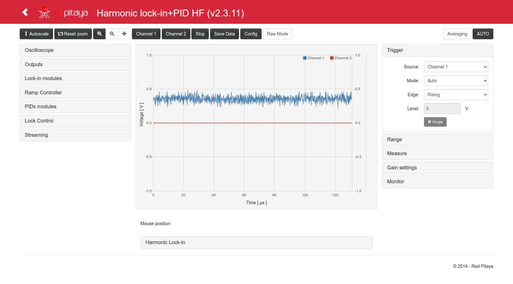

- **Top toolbar**: zoom and acquisition buttons.
- **Left column**: the instruments (Oscilloscope, Outputs, Lock-in modules, Ramp Controller, PIDs modules,
  Lock Control, Streaming). Each title opens or closes its panel.
- **Centre**: the plot (two Y axes, Channel 1 blue and Channel 2 red), the mouse position, and the
  *Harmonic Lock-in* display (X, Y, R, φ, F1, F2, F3).
- **Right column**: the original scope controls (Trigger, Range, Measure, Gain settings) and the Monitor.

Every change is sent to the board when the field loses focus or Enter is pressed (Escape cancels the edit).
Only changed values are sent. A field left empty (e.g. after Backspace) or with an invalid text is **not** sent:
the last value comes back.

Careful with the **mouse wheel over the plot**: it zooms the time axis, which changes the decimation of the
scope (a `POST /data`). Over a focused number field the wheel changes the value by one step.

## Panels

### Toolbar

| Button | Action |
|---|---|
| Autoscale | Rescales the **Y axis** to the data on screen, only in the page. Does not end a lock capture. |
| Reset zoom, zoom in/out, pan | Plot navigation. A zoom selects the time window of the acquisition (the decimation is chosen from it). Reset zoom (v2.3.14) sets the window from t = 0 to one period of the ramp (Ext Trig = Scan floor / Scan ceil), one period of the HF modulation (Ext Trig = harmonic mod., 120·(hp+1) ticks) or one whole memory at the current decimation (otherwise), and Y to −1 … 1 V (raw mode −8192 … 8192). Periods of 1.5 s or more: 0.98 × the period, so that every scan is acquired. During a lock capture it first ends it, as AUTO, and uses the restored Ext Trig. The Raw Mode button rescales Y the same way. |
| Mouse wheel on the plot (v2.3.14) | Zoom centred on the mouse, 1.5× per step. **No key:** both axes (time and the two Y axes). **SHIFT** held: time axis only (the cursor becomes a horizontal double arrow ↔). **ALT** held: Y axes only (vertical double arrow ↕; in raw mode the Y range is in counts). The time window is sent to the controller once the wheel stops (250 ms), which chooses the decimation as for any zoom; it stays between 20 ns and 68.7 s. The Y zoom is only in the page (1/2048 … 1000 × full scale). During a lock capture the wheel zoom is only in the page; ending the capture restores the window saved before it. The wheel on the number fields is not affected (SHIFT ×10, CTRL ×100). |
| Channel 1 / Channel 2 | Show or hide each channel. |
| Stop | Stops the acquisition. |
| Save Data | Plot data as Python/Numpy, Matlab/Octave or CSV ([Saving data](#saving-data)). |
| Config | Save / load configurations ([below](#saving-and-loading-configurations)). |
| Raw Mode | Values in counts (`int`) instead of volts. |
| Averaging | Average inside the decimation. |
| **AUTO** | Auto-set of the scope in the controller (time range, trigger, Y range). Ends a lock capture. Not the same as *Autoscale*. |

### Oscilloscope

- **OscA / OscB**: signal shown on Channel 1 / Channel 2 (any of 25 internal signals:
  in1, in2, error, ctrl_A, ctrl_B, Ramp A/B, PID inputs/outputs, references, Xo, Yo, F1o..F3o, signal_i,
  out1, out2). The fast inputs are seen with `in1`/`in2`.
- **Ext Trig**: event used when the scope trigger *Source* is *External*: None, Pin (DIO0_P), Scan floor,
  Scan ceil, harmonic mod. (start of each modulation period), Out of lock, Jump trigger, Lock control trig
  (the lock event; used by Capture Lock). *Square mod.* is not implemented (always 0 in the FPGA) and is not in the
  menu since v2.3.14.
- **More options**: *R|Phase Mode* (disabled in this version) and *Disable anti-aliasing filter* for each
  channel.

The time range goes up to 68.7 s (decimation 524288):

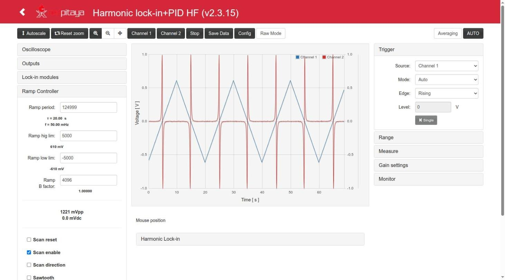

### Outputs

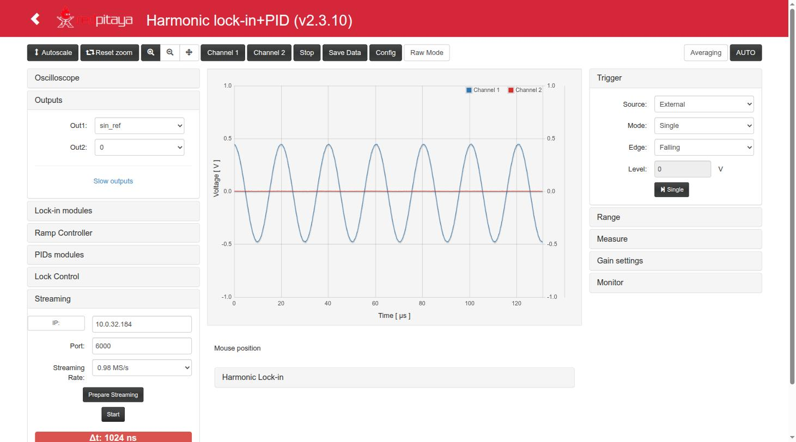

- **Out1 / Out2**: signal sent to each fast output (±1 V): 0, in1, in2, in1−in2, error, cos_1f, cos_2f,
  cos_3f, cos_ref, sin_ref, PID A out, PID B out, ctrl_A, ctrl_B, aux_A, aux_B. For a lock, Out1 = ctrl_A
  (ramp + PID A) is the usual choice.
- **Slow outputs**: four selectors. **They have no effect in this version** (the slow outputs are not
  driven by the FPGA, see [App.md](App.md#inputs-and-outputs)).
- The modulation of *A Out1* / *A Out2* (Lock-in modules → Auxiliar) is added to the output **even when Out1 /
  Out2 = 0**: to leave an output really at 0 V set also its modulation amplitude to −1.

### Lock-in modules

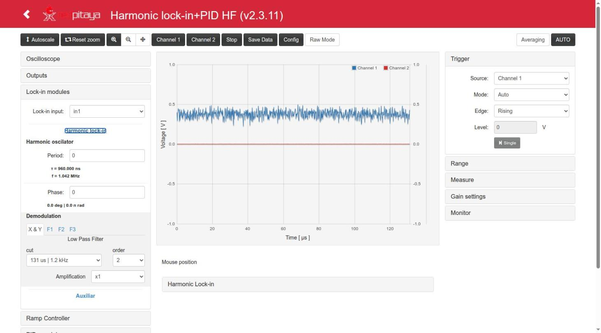

- **Lock-in input**: signal to demodulate (in1, in2, in1−in2, cos_ref, sin_ref, cos_1f, aux_A, Ramp A).
- **Harmonic oscillator**: *Period* (`gen_mod_hp`, 0..16383; shows τ and f below: **0 → τ = 960 ns, f = 1.042 MHz**;
  20 → 49.603 kHz; 16383 → 63.58 Hz) and *Phase* of the F1/F2/F3 references (**0..119 = 0..357°, 3° per step**;
  shown in degrees and π rad below).
- **Demodulation**: tabs *X & Y*, *F1*, *F2*, *F3*, each with its low-pass filter (*cut* = τ | f, *order*
  OFF/1/2) and *Amplification* (×2ⁿ). The filters are the same as in `lock_in+pid_harmonic` (131 µs | 1.2 kHz ..
  4.29 s | 37 mHz).
- **Auxiliar**: *Aux A*, *Aux B* constants, and **Modulation Amplitude** *A Out1* / *A Out2*: amplitude of
  the reference added to OUT1 (`cos_ref`) / OUT2 (`sin_ref`); −1 = off, 0..8191 (≈ value/16384 V).

Frequency vs. *Period* (f = 125 MHz / (120·(Period + 1))): 0 → 1.042 MHz, 1 → 520.8 kHz, 2 → 347.2 kHz,
4 → 208.3 kHz, 9 → 104.2 kHz, 20 → 49.6 kHz, 119 → 8.68 kHz, 1041 → 1.00 kHz. The step between available
frequencies is large near the top.

### Ramp Controller

- **Ramp period** (`ramp_step`: ticks per step − 1; below, the resulting period τ and frequency f),
  **Ramp hig lim**, **Ramp low lim** (in counts, with the value in mV below), **Ramp B factor**
  (4096 = 1: ratio of Ramp B to Ramp A). The amplitude (mVpp) and centre (mVdc) are shown below.
- **Scan reset** (hold at 0), **Scan enable** (the ramp runs; the *Scan enable* button of Lock Control
  must also be on), **Scan direction**, **Sawtooth** (otherwise triangle).

Example (test config `lock_mode`): ±5000 counts (±610 mV), period 400, triangle → 64.16 ms.

### PIDs modules

- **Error signal selector**: *Error signal* (0, Xo, Yo, F1o, F2o, F3o, in1, in1−in2) and its *offset*.
- **PID A / PID B**: *input* (error by default), *reset integral*, *freeze out*, *freeze integral*, and
  the gains *kp*, *ki*, *kd* with the effective value written below (kp as a factor, ki and kd as τ and f).
- **More Options** shows the set point *sp*, the scale selectors of kp (/1../4096), ki (8 ns..9 s; option 4 is
  "65 us") and kd (7.5 ns..491.5 µs), and *SAT lim* (saturation of the integral term, ±122 µV..±1 V):

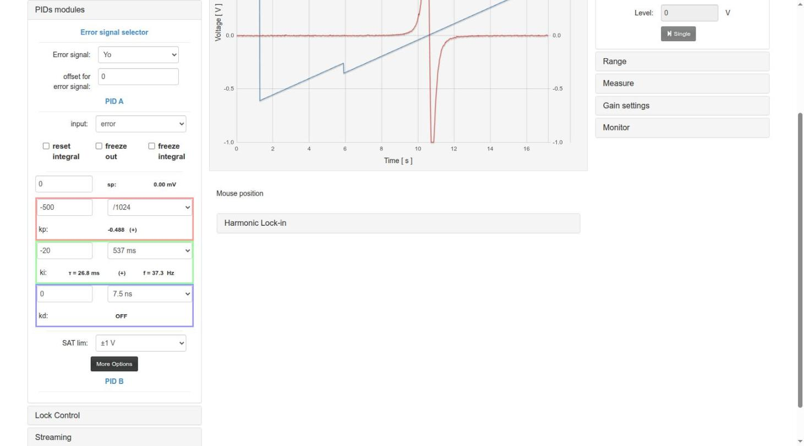

In the example kp = −500 with /1024 gives −0.488, and ki = −20 with 537 ms gives τ = 26.8 ms.

### Lock Control

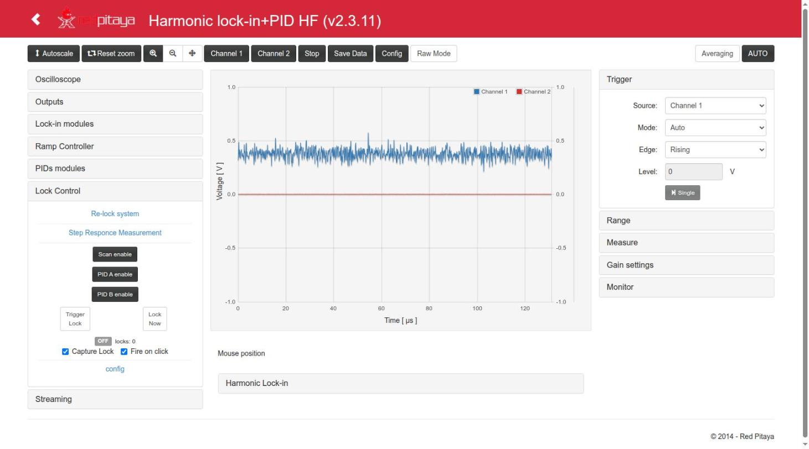

The main part of the panel (from top to bottom):

- **Scan enable / PID A enable / PID B enable**: buttons with the **effective** state of the ramp and the
  PIDs (dark = on). When nothing is locked a click toggles the manual enable; while LOCKED a click
  releases the lock keeping the other enables.
- **Trigger Lock**: arms the lock; it closes when the trigger of the *config* section happens (time,
  level or level+time). **Lock Now**: closes the lock at once. Both stay pressed while requested; a second
  click releases the lock.
- **State label**: OFF / ARMED / LOCKED and the number of locks since the FPGA was loaded.
- **Capture Lock** (on by default): every lock request from the page captures the closing of the loop in
  the scope and freezes the trace. **Fire on click** (on by default): with *Choose from graph*, a click on
  the plot sets the trigger value and fires *Trigger Lock*. Design: [`lock_capture.md`](../lock_in+pid_harmonic_hf/doc/lock_capture.md).
- **config** (open it with its title):

  - *Scan enable*, *PID A enable*, *PID B enable*: what is on **while LOCKED** (usually: scan off, PID A on).
  - *Trigger type*: OFF (only Lock Now), Time trigger, Level Trigger, Level+time Trigger.
  - *Time trigger*: delay after the scan floor, in ticks of 8 ns or with units (`16.58 ms`, `20 s`; see
    [below](#typing-values-with-units)); shown as T below (2072622 = 16.58 ms). 0 = OFF, up to 4294967295 = 34.36 s.
  - *Signal for trigger*, *Level trigger* (counts or `V`/`mV`, shown in mV below), *trig upward?*: for the level
    trigger. In this App the level trigger acts one clock (8 ns) later than in `lock_in+pid_harmonic`
    ([App.md](App.md#lock-control-auto-lock)).
  - **Choose from graph**: the next click on the plot sets the time (or the level, depending on the trigger type)
    of the trigger. A second click on the button (*Cancel*) or Esc cancels it. A red warning appears if the scope
    is not in Normal/Single + External + Scan floor (the only setup where t = 0 of the plot is the scan floor).

- **Re-lock system** and **Step Responce Measurement** (open them with their titles):

  - Re-lock: *Error Enable* with `|error| >` threshold, *Signal Enable* with a signal `<` threshold,
    *RL reset*. Not tested on this version (see [App.md](App.md#re-lock-and-step-response)).
  - Step response: *Jump ctrl_A*, *Jump ctrl_B*, *Freeze during step* (A/B out, A/B int), *Start Step Responce*.

How the lock control works inside: [`lock_control.md`](../lock_in+pid_harmonic_hf/doc/lock_control.md).

### Streaming

See the Outputs screenshot above.

- **IP** (the *IP* button fills in the address of the computer running the browser), **Port** (6000 for
  the server of `resources/streaming`), **Streaming Rate** (1.95 MS/s .. 1.9 kS/s; 0.98 MS/s is the fastest
  continuous rate).
- **Prepare Streaming** starts `c/streaming` on the board; **Start** / **Stop** send the data.
- Start the receiver on the computer first (`resources/streaming/server`, or `nc -l <port>`); details in
  `resources/README.md`. Tested in v2.3.11 at 0.98 MS/s: 26.5 s, no discontinuities ([App.md](App.md#streaming)).

### Right panels and displays

- **Trigger**: *Source* (Channel 1, Channel 2, External), *Mode* (Auto, Normal, Single), *Edge*, *Level*,
  and the *Single* button. External uses the *Ext Trig* of the Oscilloscope panel.
- **Range**: buttons for the X and Y scales and offsets.
- **Measure**: min, max, amplitude, average, frequency and period of each channel.
- **Gain settings**: probe attenuation (1x/10x) and LV/HV jumper setting of each input (scale of the display).
- **Harmonic Lock-in** (below the plot): X, Y, R, φ, F1, F2, F3 in volts.
- **Monitor**: mean and standard deviation of the error over ~1 s, in counts.

## Typing values with units

The **Time trigger** and **Level trigger** fields of *Lock Control → config* are text fields that accept a number
with a unit (`index.html` l. 2221-2262, `parseTrigTime()` l. 2242, `parseTrigLevel()` l. 2249):

| Field | Without unit | Units | Range | Examples |
|---|---|---|---|---|
| Time trigger | ticks of 8 ns | `s` (`seg`), `ms`, `us` (`µs`), `ns`, `tick(s)` | 0 .. 4294967295 (34.36 s); larger values are clamped; a nonzero time below one tick is 1 tick | `16.58 ms` → 2072500, `20 s` → 2500000000, `40 s` → 4294967295 |
| Level trigger | counts | `V`, `mV`, `count(s)` | −8192 .. 8191 (clamped) | `0.1 V` → 819, `120 mV` → 983 |

- Decimal point or comma; the space between number and unit is optional; units are not case sensitive.
- The value is sent when the edit ends (Enter or leaving the field); then the field is rewritten in ticks /
  counts and T / V_trg below it are updated. Escape restores the previous value.
- An empty or invalid text (`abc`, `-5 ms`) is not sent: a red hint appears below the field and the last value
  comes back. The mouse wheel changes the value by one tick / count.
- Values above 2²⁴ ticks (134 ms) go through the float parameters of the C controller and are rounded to a
  multiple of 2 to 256 ticks; see [FPGA.md](FPGA.md#lock-control-auto-lock).

Tested on the board with this App (v2.3.11, testAgent 2026-10-10 19:35): `16.58 ms` → 2072500, `20 s` →
2500000000, `40 s` → 4294967295 (T = 34.360 s), `2072622`, empty and `abc` + Enter → nothing sent; `0.1 V` → 819,
`120 mV` → 983, `5085`.

Other fields have older unit conversions in the JavaScript (`index.html` l. 1794-2269), but they are
`<input type="number">` fields, where browsers do not let letters be typed: **a confirmar** whether they can be
used from the UI. Those conversions are:

| Field | Units |
|---|---|
| Ramp hig/low lim, PID sp | `V`, `mV` (converted to counts) |
| Ramp period | `s`, `ms` (see the limitation below) |
| Period of the harmonic oscillator | `s`, `ms`, `us` (with the HF period: `Period = round(T / (120 · 8 ns)) − 1`, `index.html` l. 2153-2161) |
| Phase | `deg`, `rad`, `pi` (converted with 120 points per turn, l. 2141-2151) |

## HF notes

Practical points that are specific to this App:

- **Configs of `lock_in+pid_harmonic` give another frequency here.** They have the same keys, and their
  `lock_gen_mod_hp` is kept as is: the test configs of `_h` have hp = 0, which is **49.6 kHz in `_h` and
  1.04 MHz in HF**. For the same 49.6 kHz use hp = 20. Their `lock_gen_mod_phase` (0..2519) is clipped to 119.
  For the test bench use `test_files/lock_in+pid_harmonic_hf__lock_mode.json` (hp 20).
- Configs saved in the browser by `_h` (key `lockConfig_lock_in+pid_harmonic`) or by old versions (shared key
  `lockConfig`) **do not appear in the list** of this App: the old key is not migrated on purpose (the configs
  of both Apps can not be told apart). Use *Save as file* in the other App and *Load file* here.
- **Higher frequency, less signal.** If the system under test (or its electronics) filters the modulation, its
  effect on the response goes down with the frequency. In the test bench (input filter of ~19.9 kHz in
  `dummy_simulator`) going from 49.6 kHz to 104 kHz made the derivative signal ×0.58 smaller; doubling the
  modulation amplitude (`mod_out1` 100 → 200) brought it back, and then **kp had to be halved** (−500 → −250)
  because the loop gain had grown and the loop oscillated at ~4.85 kHz ([procedure 5](#5-locking-at-a-higher-frequency-example-104-khz)).
- The phase between the error signal and the references changes with the frequency (delays of the system and of
  the board). Check X and Y (or F1 with *Phase*) after every change of *Period*; `gen_mod_phase` only rotates
  `cos_1f..3f` (F1..F3), not X/Y.
- Near 1 MHz the 2f and 3f components (2.08 and 3.13 MHz) are close to the bandwidth of the analog front end of
  the board (**a confirmar**), and only a few points per period are generated (120 at 1f, 40 at 3f).
- A lock at 1.04 MHz has **not been tested** with the bench (`dummy_simulator` does not respond at that frequency).

## Procedures

These procedures follow `test_files/lock_test.md`, the procedure used to test every version on the board.
The example numbers are those of the test configuration `test_files/lock_in+pid_harmonic_hf__lock_mode.json`
(49.6 kHz): a system with a resonance (a peak) whose control input is OUT1 and whose response is measured on IN1.

### 1. Scan and see the response of the system

1. **Outputs**: Out1 = `ctrl_A`.
2. **Ramp Controller**: limits ±5000 (±610 mV), period 400 (triangle: 64.16 ms), *Scan enable* checked.
3. **Lock Control**: *Scan enable* button on, *PID A enable* off.
4. **Oscilloscope**: OscA = `Ramp A` (or `ctrl_A`), OscB = `in1`; Ext Trig = *Scan floor*.
5. **Trigger**: Source *External*, Mode *Normal*. Zoom to one period of the ramp (0..64 ms): t = 0 is the
   scan floor.

The response of the system (the peak) appears on Channel 2 at the same position in every sweep.

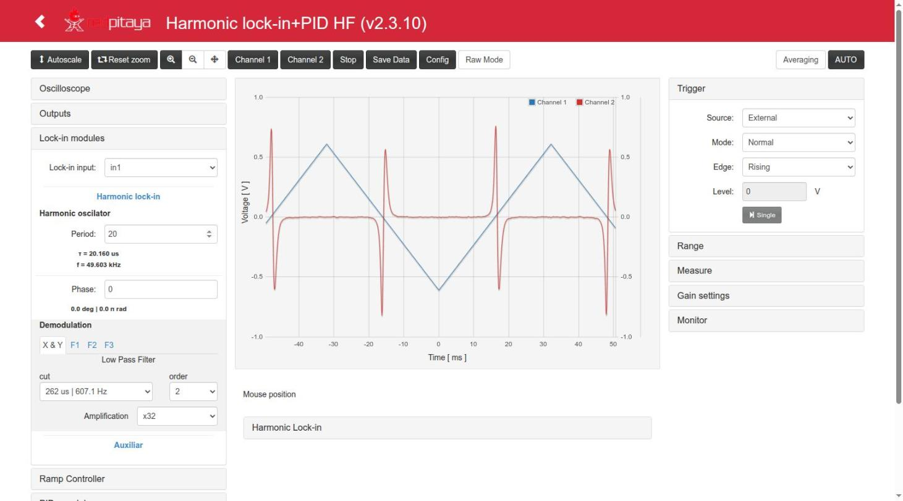

### 2. Configure the lock-in to get an error signal

The lock-in, with a small modulation added to the control signal, gives a signal proportional to the
derivative of the response with respect to the scan: it crosses zero at the maximum of the peak, which is
the error signal for the PID.

1. **Lock-in modules**: Lock-in input = `in1`; **Period = 20 (49.6 kHz)**; *A Out1* = 100 (modulation of ≈ 6 mV
   added to OUT1); X & Y filter 262 µs | 607 Hz, order 2; Amplification ×32.
2. Look at `Xo` and `Yo` (OscA/OscB) during the scan and choose the component (X or Y) that gives a clean
   dispersive curve with a zero crossing at the peak (in the test: Y, lobes +0.75 / −0.61 V; X smaller).
3. **PIDs modules**: Error signal = that component (`Yo` in the test configuration), offset 0.
4. OscA = `ctrl_A`, OscB = `error`:

### 3. Close the lock

1. **PID A**: input = error, kp = −500 (/1024), ki = −20 (537 ms). The sign of the gains has to give
   negative feedback around the zero crossing (try the other sign if the lock runs away). kp = −250 gives a
   quieter lock in the test bench (error std ~3.3 mV instead of ~8 mV).
2. **Lock Control → config**: while locked, *PID A enable* on and *Scan enable* off.
3. Choose the trigger:
   - **Time trigger**: press *Choose from graph* and click on the zero crossing of the error (≈ 16.6 ms in
     the example). With *Fire on click* on, the click also fires *Trigger Lock*.
   - **Level trigger**: Signal for trigger = error, Level = the value of the error just before the
     crossing (5085 counts = 621 mV in the test), *trig upward?* according to the slope.
   - **Lock Now**: locks immediately wherever the ramp is (useful only when the system is already near the
     point).
4. Press **Trigger Lock**. The state goes OFF → ARMED → LOCKED in the next sweep; with *Capture Lock* the
   scope shows the closing of the loop (t = 0 is the lock) and keeps it frozen:

With the level trigger (here with Capture Lock off, last sweep in Normal mode):

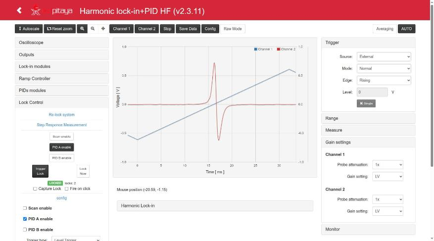

Fire on click on a frozen capture moves the lock point and locks again:

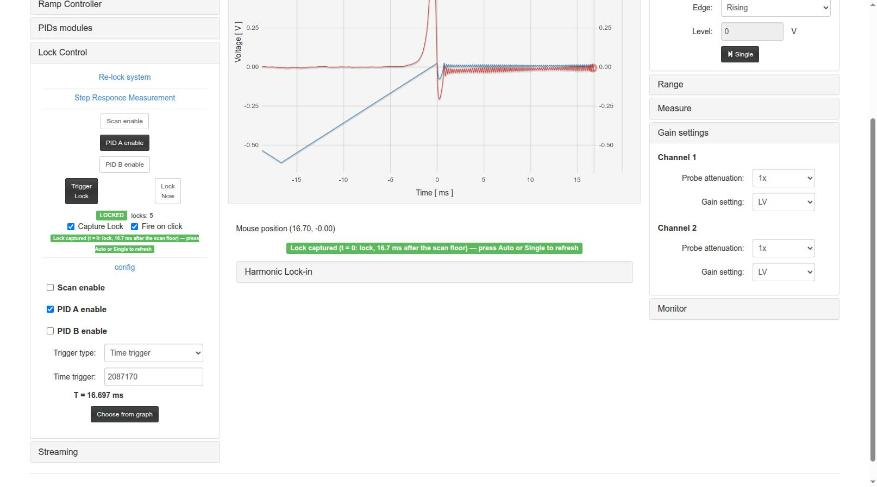

With a long time trigger the state stays ARMED until the time is reached (here 40 s, clamped to 34.36 s):

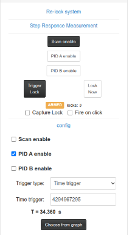

The whole sequence (Choose from graph → Trigger Lock → Auto → release → Level → Lock Now → ARMED → units →
Capture Lock → AUTO → Fire on click) in a GIF: [lock_sequence_49k6.gif](.Usage/lock_sequence_49k6.gif).

If *Choose from graph* shows the red warning, t = 0 of the plot is not the scan floor and the time taken
from the click would be wrong:

The frozen capture ends (and the scope settings saved before the capture are restored) with trigger mode
Auto/Normal, *Single*, **AUTO**, a change of source or Ext Trig, unchecking *Capture Lock*, or a release
while waiting. *Autoscale* keeps it.

### 4. Check the lock and release it

1. Set the trigger Mode to **Auto**: the ramp has stopped and the error stays at 0 (OscA = `ctrl_A`,
   OscB = `error`):

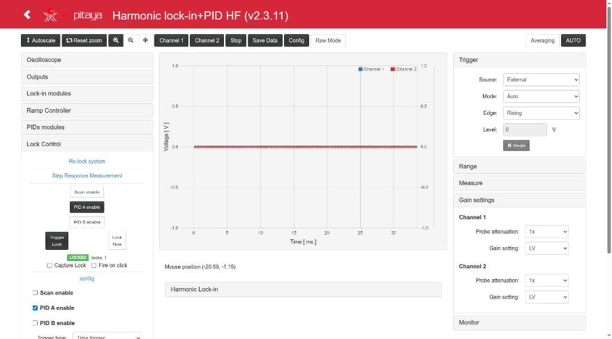

2. With OscA = `in1` the signal stays at the top of the peak (IN1 ≈ 0.44 V = the peak in the test):

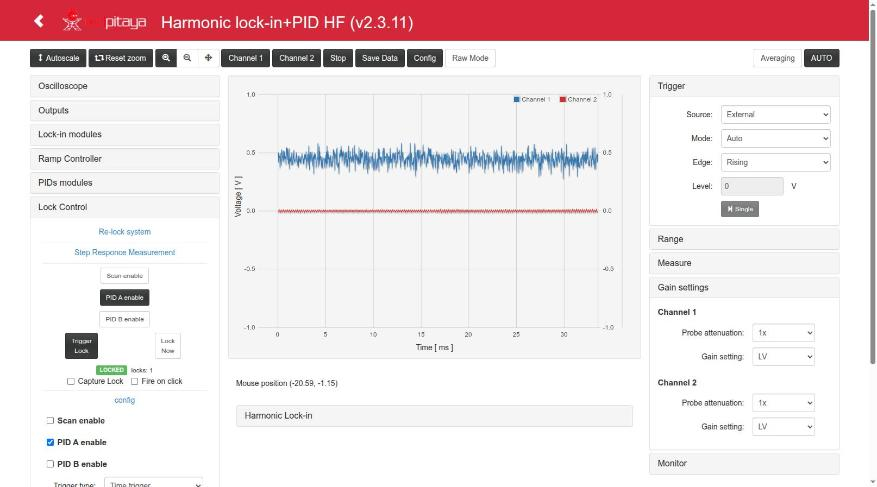

3. The **Monitor** panel shows the mean (≈ 0) and the std of the error (≈ 62 counts ≈ 7.5 mV in the test with
   kp −500).
4. **Release**: a second click on *Trigger Lock* (or *Lock Now*), or a click on *Scan enable* (restarts the
   scan with the PIDs as they were).

A lock can also be closed and checked without the web page, with `py/lock_from_registers.py` on the board
or over HTTP (see [Remote.md](Remote.md)); the page follows the state without sending anything.

### 5. Locking at a higher frequency (example: 104 kHz)

Done on the board with v2.3.11 against the same simulated peak (`reportes/lock-in_pid_h_hf_lock_test/2026-10-10_19:39:00_lock.md` §3):

1. Start from the 49.6 kHz lock above and set **Period = 9** (104.17 kHz).
2. Look at X and Y during the scan (OscA = `Xo`, OscB = `Yo`). With *A Out1* = 100 the Y signal was ×0.58
   smaller (+0.44 / −0.32 V), X almost 0:

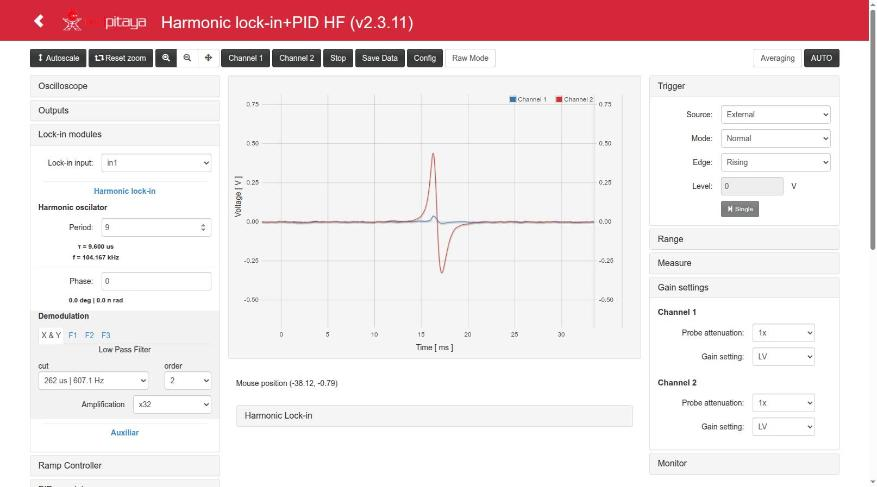

3. **A Out1 = 200**: Y back to +0.88 / −0.64 V, zero crossing still in Y, so the error selector and the sign of
   kp/ki stay the same.
4. Lock with kp = −500: it locks but oscillates at ~4.85 kHz (error std 16 mV) — too much gain:

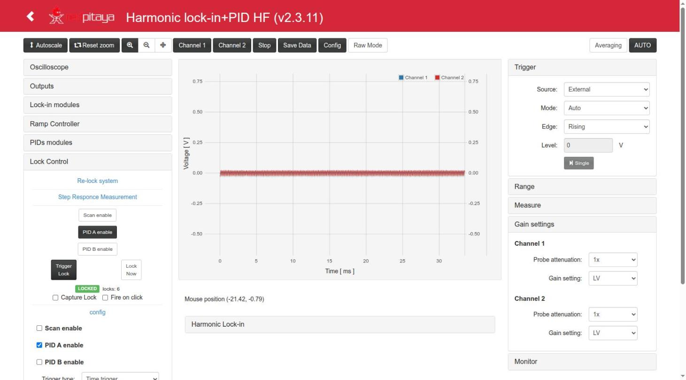

5. **kp = −250**: stable lock, error std 1.3-1.5 mV, IN1 = 1.03 × the peak:

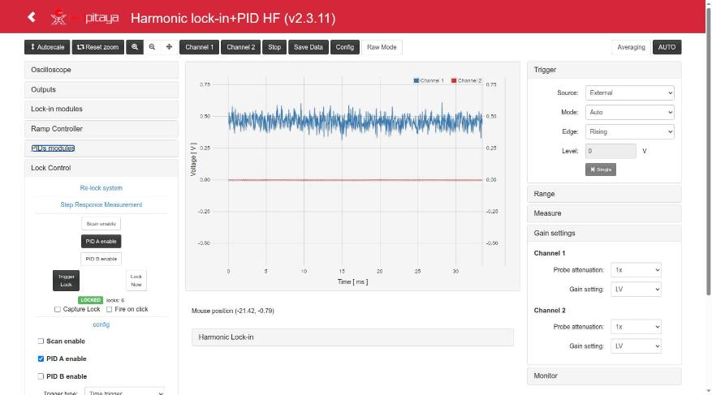

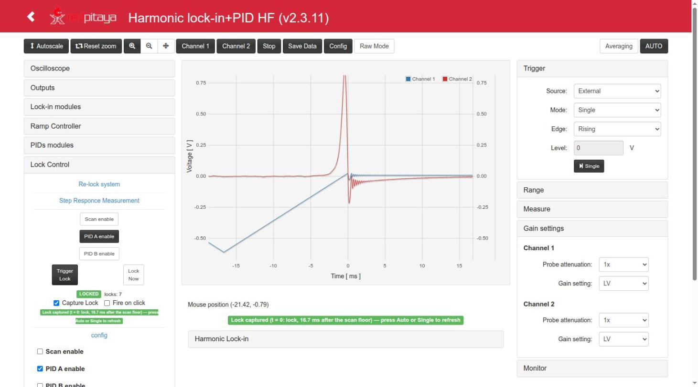

The result is saved as `test_files/lock_in+pid_harmonic_hf__lock_mode_100k.json` (hp 9, `mod_out1` 200,
kp −250). In general: after moving the modulation frequency, re-check the size and the phase of the error signal
and retune the gains.

## Saving and loading configurations

**Config** opens the configuration dialog:

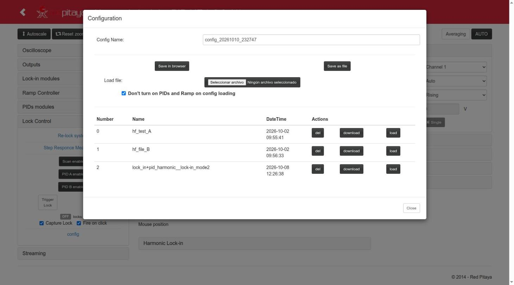

- *Save in browser* stores all the parameters (and the Capture Lock / Fire on click preferences) under the
  *Config Name* in the browser (`localStorage`, key `lockConfig_lock_in+pid_harmonic_hf`). *Save as file*
  downloads a JSON.
- The list shows the saved configs with *del*, *download* and *load*. *Load file* adds a JSON file to the list
  (then press its *load*).
- **Don't turn on PIDs and Ramp on config loading**: when checked, a loaded config never turns on the
  ramp, the PIDs or a lock request (safe default when the outputs are connected to an experiment).
- Configs are per browser, not stored on the board. Configs of `lock_in+pid_harmonic` must be loaded as files,
  and their *Period* has another meaning here ([HF notes](#hf-notes)).
- **Time window**: *load* applies the time window of the config in the units it was saved with (the page
  converts it and then takes the window and units of the answer of the last of the 5-9 POSTs). Tested with this
  App (v2.3.11): 6/6 loads of a config in ms from windows of 0-130 µs, 500/100/20 µs and 2 s → −2.07…33.49 ms.
  Up to v2.3.10 the window could be left in µs with the numbers of ms.
- The load does not send the scale values derived by the server (`forcex_flag`, `time_units`, `time_range`,
  `gui_xmin`, `gui_xmax`). It does send the read-only display values (`meas_*`, `lock_X`, `lock_Y`,
  `lock_lock_status`, `lock_lock_control`); the controller ignores them (seen by testAgent in v2.3.11, no effect).
- A load ends a frozen lock capture (the config brings its own scope settings).

## Saving data

*Save Data* gives the data of the plot as Python/Numpy vectors, Matlab/Octave vectors or CSV (save as a
file, copy or show).

## Several clients and Restart

Only one browser tab should control the board. When another client (another tab, the main menu, another
App) takes the board, the page stops polling and shows a dialog:

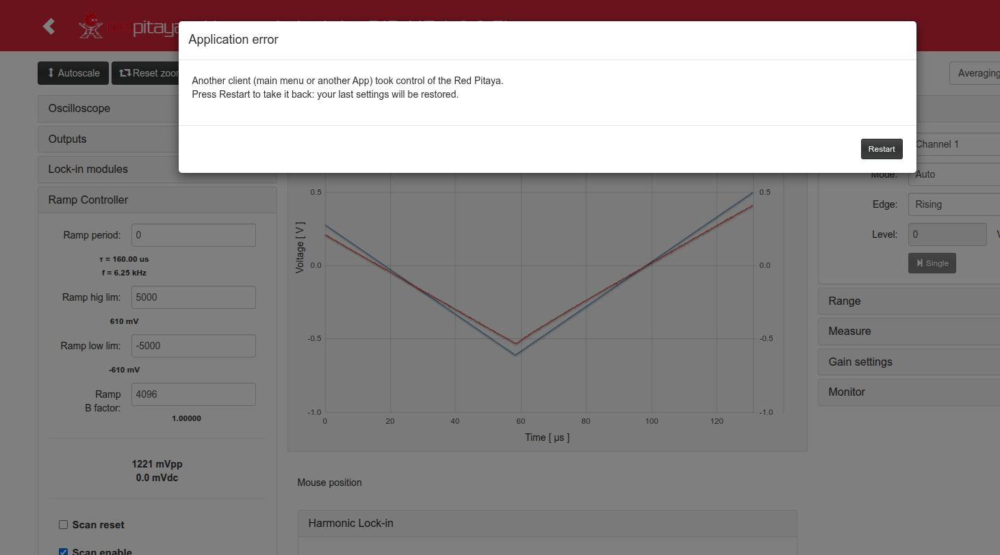

*Restart* restarts the App and restores the state of this tab (if the other client loaded the same App,
the FPGA is not reloaded). On Ecosystem 2.0 the page also enters a "cautious mode" when the board answers
slowly, and waits until it answers fast again.

## Known limitations of the interface

- The **Slow outputs** selectors have no effect; the **R|Phase Mode** button is disabled.
- *Time trigger* values above 2²⁴ ticks (134 ms) set from the page are rounded to the float32 grid (≤ 1 µs).
- *Ramp period* typed in `s`/`ms` sets `ramp_step` for (hig − low) steps, i.e. half of the period in
  triangle mode (`index.html` l. 1846-1851): check the τ shown below the field.
- *Phase* typed with units is clipped to 120 (the register maximum is 119; the C controller corrects it), and
  *Period* typed with units is clipped to 819100 (the register maximum is 16383) (`index.html` l. 2148, 2160).
- The labels of *Signal for trigger* 6-8 show code text (`/*sqXo */ 14'b0`): those options are 0.
- Each change made in the page is a `POST /data`, and on Ecosystem 2.0 each one leaves an open connection in the
  nginx of the board; after ~1000 the board stops answering until nginx is restarted
  ([Remote.md](Remote.md#known-issue-of-the-ecosystem-post-data-leaves-connections-open)).
- Level+time with the time after the level crossing stays ARMED (the level crossing has to happen after
  the time).

These items are listed for devAgent in `docAgent.md`.
